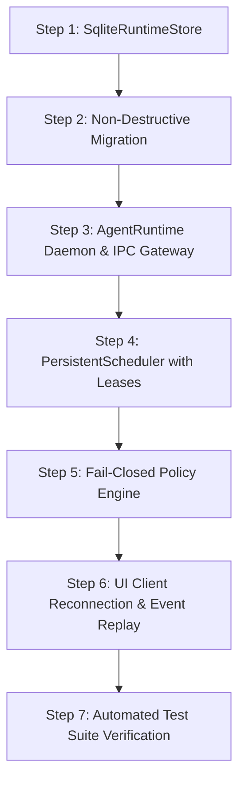

# MUSE V3 — ALWAYS-ON PERSONAL AI AGENT SPECIFICATION
## Comprehensive Architectural Blueprint & Sprint 1 Implementation Plan

**Project:** Muse — Autonomous Personal AI Companion  
**Version:** 3.0-Draft  
**Date:** November 14, 2026  
**Status:** Approved for Sprint 1 Execution  
**Benchmark:** OpenAI Dots (Always-On Background Proactivity) + Meta Muse (Conversational-First Companion UI)

---

## 1. Executive Summary & Product Positioning

### 1.1 The Next Evolution of Muse
Muse V1 established the local agent foundation (ModelRouter, SentinelGuard, ToolCreator, BrowserSandbox).  
Muse V2 transformed the interface into a Meta Muse-inspired conversational companion with a living mini-avatar, center-stage chat, inline task cards, and an on-demand contextual work surface drawer.

**Muse V3** advances Muse from a reactive assistant into an **Always-On Personal AI Agent**, benchmarked against **OpenAI Dots**:
- **Continuous Background Operation:** Muse does not die when the browser or UI window closes. An independent local background service (`AgentRuntime`) continues executing background research, monitoring, and scheduled tasks.
- **Controlled Proactivity:** Muse periodically checks approved sources (e.g., flight fares, product prices, news feeds, documentation) and surfaces high-value insights directly into the user's conversation stream without waiting for explicit prompt requests.
- **Fail-Closed Security & Conservative Approvals:** Muse strictly enforces a read-only boundary for proactive background tasks. Any external write, communication, or financial transaction requires interactive human approval via SentinelGuard.
- **Strict Separation of Concerns:** Muse (`D:\Mose-ai`) remains 100% physically, architecturally, and procedurally isolated from OpenCode Chat (`D:\opencode-vedio-etc`).

---

## 2. Benchmark Comparison: Muse V3 vs. OpenAI Dots & Meta Muse

| Capability Dimension | Meta Muse | OpenAI Dots | Muse V3 Implementation |
| :--- | :--- | :--- | :--- |
| **Interaction Model** | One continuous conversation, living character avatar, contextual drawer | Chat-centric, proactive notifications | **Conversational-first**, living SVG avatar, inline progress cards, slide-out contextual work surface |
| **Runtime Topology** | Cloud service + app client | Always-on cloud computer / sandbox | **Hybrid Local-First Service**: Persistent background Windows daemon (`AgentRuntime`) with local SQLite store |
| **Proactive Research** | Context-driven suggestions | Autonomous background research | **Approved-Source Proactive Engine**: Read-only background crawler/fetcher with strict domain whitelisting |
| **Task Continuity** | Cloud session persistence | Continuous agent lifecycle | **Transactional State Machine**: Checkpointing in SQLite (`WAL` mode), crash recovery, and execution leases |
| **Security & Approvals** | Human review for critical actions | Guardrails & action confirmation | **SentinelGuard Fail-Closed**: Hard barrier intercepting payments, emails, deletions, and untrusted execution |
| **Extensibility** | Platform integrations | Connected apps & browser computer | **Dual Extensibility**: Sandboxed Chromium browser + dynamically generated local Node.js tools |

---

## 3. High-Level Architecture (V3)

```
┌────────────────────────────────────────────────────────────────────────┐
│                   MUSE V2/V3 UI COMPANION CLIENT                      │
│      (HTML5 / CSS3 / Vanilla JS / WebSocket Client / Audio I/O)         │
│  - Living Avatar (Gaze & Mood)        - Center-Stage Chat (800px)      │
│  - Inline Task Execution Cards        - Contextual Work Surface Drawer │
└───────────────────────────────────┬────────────────────────────────────┘
                                    │ WebSocket (Bidirectional Events & Event Replay)
                                    ▼
┌────────────────────────────────────────────────────────────────────────┐
│                      MUSE AGENT RUNTIME DAEMON                         │
│                    (Independent Local Service)                         │
│                                                                        │
│  ┌───────────────────────┐              ┌───────────────────────────┐  │
│  │   Event & Replay      │              │   Persistent Scheduler    │  │
│  │   Gateway (WS / IPC)  │              │   (Cron & Interval Loop)  │  │
│  └──────────┬────────────┘              └─────────────┬─────────────┘  │
│             │                                         │                │
│             ▼                                         ▼                │
│  ┌──────────────────────────────────────────────────────────────────┐  │
│  │                      Task Execution Engine                       │  │
│  │     (Durable State Machine, Checkpointing & Recovery Worker)     │  │
│  └──────────────────────────────────┬───────────────────────────────┘  │
│                                     │                                  │
│             ┌───────────────────────┴───────────────────────┐          │
│             ▼                                               ▼          │
│  ┌─────────────────────────────┐              ┌──────────────────────┐ │
│  │    Sentinel Policy Engine   │              │   Proactive Engine   │ │
│  │  (Research / Action / HITL) │              │  (Read-Only Monitor) │ │
│  └──────────┬──────────────────┘              └─────────────┬────────┘ │
│             │                                               │          │
│             ▼                                               ▼          │
│  ┌──────────────────────────────────────────────────────────────────┐  │
│  │                    SqliteRuntimeStore                            │  │
│  │  (.mose/runtime.db - WAL Mode, Atomic Transactions, Leases)      │  │
│  └──────────────────────────────────────────────────────────────────┘  │
└────────────────────────────────────────────────────────────────────────┘
```

---

## 4. Sprint 1 Detailed Specifications (Runtime Foundation)

### 4.1 System Components

#### 4.1.1 `AgentRuntime` (Service Lifecycle Manager)
- **Path:** `packages/core/src/runtime/agent_runtime.js`
- **Role:** Central daemon managing background operations, task queue, scheduler, and client connections.
- **Key Responsibilities:**
  1. Bootstraps the SQLite storage engine and runs schema migrations.
  2. Spawns and manages the `PersistentScheduler`.
  3. Detects incomplete tasks upon startup (`status IN ('queued', 'planning', 'running', 'waiting_approval')`) and initializes crash recovery.
  4. Manages the WebSocket event server (default port `3000`), allowing companion UI clients to attach/detach freely.
  5. Records all runtime events in an append-only event stream table (`runtime_events`) for event replay upon UI reconnect.

#### 4.1.2 `SqliteRuntimeStore` (Transactional Storage Engine)
- **Path:** `packages/core/src/storage/runtime_store.js`
- **Role:** Replaces legacy JSON files (`tasks.json`, `goals.json`, `executed_actions.json`, `conversations.json`, `memory.json`) with an ACID-compliant transactional database powered by Node.js built-in `node:sqlite` (`DatabaseSync`).
- **Engine Features:**
  - WAL Mode: `PRAGMA journal_mode = WAL;` (enables high-throughput concurrent reads and writes).
  - Foreign Keys: `PRAGMA foreign_keys = ON;`.
  - Immediate Transactions: Atomic `BEGIN IMMEDIATE` guarantees zero write conflicts and prevents deadlocks.
  - Safe Migration Utility: On first boot, existing `.mose/*.json` files are automatically parsed, loaded into SQLite tables, and backed up to `.mose/backup_json/`.

#### 4.1.3 `PersistentScheduler` (Occurrence Engine & Leases)
- **Path:** `packages/core/src/runtime/persistent_scheduler.js`
- **Role:** Handles cron schedules, intervals, and periodic monitoring jobs (e.g., flight price watchers, news monitors).
- **Execution Leases:**
  - Before a scheduled job triggers, it must acquire an atomic execution lease in `execution_leases`.
  - Guarantees that even if multiple worker threads or processes exist, each scheduled occurrence is executed exactly once.

#### 4.1.4 `SentinelPolicyEngine` (Fail-Closed Security Matrix)
- **Path:** `packages/core/src/security/policy_engine.js`
- **Role:** Implements strict, independent policy gates that cannot be overridden by model outputs:
  1. **`ResearchPolicy`:** Strictly limits background proactive crawlers to HTTP GET / DOM extract on approved domains. Blocks form submission, POST/PUT/DELETE requests, external script injection, and cookie transmission.
  2. **`ActionPolicy`:** Categorizes tool and system actions (safe, restricted, dangerous).
  3. **`ApprovalPolicy`:** Enforces interactive human-in-the-loop authorization for sensitive operations.
  4. **`ExecutionPolicy`:** Validates idempotency keys and active execution leases prior to invoking any side-effect tool.

---

## 5. Database Schema Specification (`.mose/runtime.db`)

```sql
-- 1. Tasks
CREATE TABLE IF NOT EXISTS tasks (
    id TEXT PRIMARY KEY,
    goal_id TEXT,
    title TEXT NOT NULL,
    status TEXT NOT NULL CHECK(status IN ('queued', 'planning', 'running', 'waiting_approval', 'completed', 'failed', 'paused')),
    step INTEGER NOT NULL DEFAULT 0,
    progress INTEGER NOT NULL DEFAULT 0,
    metadata_json TEXT DEFAULT '{}',
    created_at TEXT NOT NULL,
    updated_at TEXT NOT NULL
);

-- 2. Checkpoints
CREATE TABLE IF NOT EXISTS checkpoints (
    id TEXT PRIMARY KEY,
    task_id TEXT NOT NULL,
    step INTEGER NOT NULL,
    status TEXT NOT NULL,
    description TEXT,
    messages_json TEXT,
    timestamp TEXT NOT NULL,
    FOREIGN KEY(task_id) REFERENCES tasks(id) ON DELETE CASCADE
);

-- 3. Execution Leases (Prevents dual execution across workers)
CREATE TABLE IF NOT EXISTS execution_leases (
    id TEXT PRIMARY KEY,
    resource_type TEXT NOT NULL,
    resource_id TEXT NOT NULL,
    owner_id TEXT NOT NULL,
    expires_at TEXT NOT NULL,
    acquired_at TEXT NOT NULL,
    UNIQUE(resource_type, resource_id)
);

-- 4. Idempotency Keys (Prevents duplicate side-effects)
CREATE TABLE IF NOT EXISTS idempotency_keys (
    key TEXT PRIMARY KEY,
    action_type TEXT NOT NULL,
    payload_hash TEXT NOT NULL,
    result_json TEXT,
    executed_at TEXT NOT NULL
);

-- 5. Schedules (Recurring & Background Jobs)
CREATE TABLE IF NOT EXISTS schedules (
    id TEXT PRIMARY KEY,
    title TEXT NOT NULL,
    cron_expr TEXT,
    interval_ms INTEGER,
    next_run_at TEXT NOT NULL,
    last_run_at TEXT,
    status TEXT NOT NULL DEFAULT 'active' CHECK(status IN ('active', 'paused', 'completed')),
    task_template_json TEXT NOT NULL,
    is_active INTEGER NOT NULL DEFAULT 1,
    created_at TEXT NOT NULL,
    updated_at TEXT NOT NULL
);

-- 6. Sentinel Approvals (Human-in-the-Loop)
CREATE TABLE IF NOT EXISTS sentinel_approvals (
    id TEXT PRIMARY KEY,
    task_id TEXT,
    action_type TEXT NOT NULL,
    details_json TEXT NOT NULL,
    status TEXT NOT NULL DEFAULT 'pending' CHECK(status IN ('pending', 'approved', 'rejected')),
    requested_at TEXT NOT NULL,
    resolved_at TEXT,
    FOREIGN KEY(task_id) REFERENCES tasks(id) ON DELETE SET NULL
);

-- 7. Proactive Research Sources
CREATE TABLE IF NOT EXISTS research_sources (
    id TEXT PRIMARY KEY,
    domain TEXT NOT NULL UNIQUE,
    category TEXT NOT NULL,
    is_whitelisted INTEGER NOT NULL DEFAULT 1,
    is_read_only INTEGER NOT NULL DEFAULT 1,
    created_at TEXT NOT NULL
);

-- 8. Proactive Research Findings
CREATE TABLE IF NOT EXISTS research_findings (
    id TEXT PRIMARY KEY,
    source_id TEXT,
    task_id TEXT,
    title TEXT NOT NULL,
    summary TEXT NOT NULL,
    raw_content TEXT,
    confidence REAL DEFAULT 1.0,
    retrieved_at TEXT NOT NULL,
    FOREIGN KEY(source_id) REFERENCES research_sources(id) ON DELETE SET NULL,
    FOREIGN KEY(task_id) REFERENCES tasks(id) ON DELETE SET NULL
);

-- 9. Runtime Events (Event Replay for UI Reconnect)
CREATE TABLE IF NOT EXISTS runtime_events (
    id INTEGER PRIMARY KEY AUTOINCREMENT,
    event_type TEXT NOT NULL,
    payload_json TEXT NOT NULL,
    timestamp TEXT NOT NULL
);

-- 10. Memories & Conversations
CREATE TABLE IF NOT EXISTS memories (
    id TEXT PRIMARY KEY,
    key TEXT NOT NULL,
    value TEXT NOT NULL,
    category TEXT DEFAULT 'general',
    timestamp TEXT NOT NULL
);

CREATE TABLE IF NOT EXISTS conversations (
    id TEXT PRIMARY KEY,
    title TEXT NOT NULL,
    type TEXT NOT NULL DEFAULT 'project',
    messages_json TEXT DEFAULT '[]',
    created_at TEXT NOT NULL,
    updated_at TEXT NOT NULL
);
```

---

## 6. Migration Strategy

To ensure absolute safety and prevent data loss, the migration path operates as follows:
1. When `SqliteRuntimeStore` initializes, it checks whether `.mose/runtime.db` already exists.
2. If `runtime.db` is newly created, it inspects `.mose/` for legacy JSON files (`memory.json`, `goals.json`, `tasks.json`, `executed_actions.json`, `conversations.json`, `persona.json`).
3. If JSON files exist, a backup folder `.mose/backup_legacy_json_<timestamp>/` is created and all JSON files are copied there.
4. An atomic database transaction reads each JSON file and inserts records into the corresponding SQLite tables.
5. The original JSON files remain untouched or renamed with `.migrated` suffix, ensuring zero data loss and trivial rollback if necessary.
6. The `MemoryStore` API interface is preserved 100% identically, wrapping `SqliteRuntimeStore` under the hood so all existing tests and consumers continue functioning without breaking changes.

---

## 7. Sprint 1 Test Matrix

| Test ID | Test Name | Target Module | Pass Criteria |
| :--- | :--- | :--- | :--- |
| **T1** | SQLite ACID Transactions & Schema Creation | `SqliteRuntimeStore` | All 10 tables created, WAL mode verified, atomic commit verified |
| **T2** | Legacy JSON Migration & Safety | `SqliteRuntimeStore` | Automatically loads existing `.mose/*.json` without data loss or corruption |
| **T3** | Concurrency & Execution Leases | `PersistentScheduler` | Two workers attempting to lease the same schedule: 1 succeeds, 1 blocked |
| **T4** | Idempotency Key Gate | `SentinelPolicyEngine` | Duplicate execution request with identical key is rejected safely |
| **T5** | Task Crash Recovery | `AgentRuntime` | In-flight task interrupted mid-step is detected and resumed from last checkpoint |
| **T6** | Runtime Event Stream & Replay | `AgentRuntime` | WebSocket client reconnecting with `lastEventId` receives missed events |
| **T7** | Proactive Research Policy Gate | `ResearchPolicy` | Non-whitelisted domains or write operations blocked fail-closed |

---

## 8. Implementation Steps & Sequencing



1. **Phase 1: `SqliteRuntimeStore` Implementation**
   - Implement `packages/core/src/storage/runtime_store.js` using Node.js v22 `node:sqlite`.
   - Wrap in `MemoryStore` to maintain full backward compatibility with existing tests.
2. **Phase 2: Migration & Backup Automation**
   - Automatically migrate `.mose/*.json` data into `.mose/runtime.db`.
3. **Phase 3: `AgentRuntime` Background Daemon**
   - Implement `packages/core/src/runtime/agent_runtime.js` with recovery loop and event stream.
4. **Phase 4: Scheduler & Execution Leases**
   - Implement `packages/core/src/runtime/persistent_scheduler.js` with lease protection.
5. **Phase 5: Policy Engine Hardening**
   - Implement `packages/core/src/security/policy_engine.js`.
6. **Phase 6: Verification & Test Suite**
   - Add tests to `tests/runner.js` covering the complete Sprint 1 test matrix.
   - Run `npm test` and verify 100% pass rate.
   - Git commit and push to `origin/main`.
